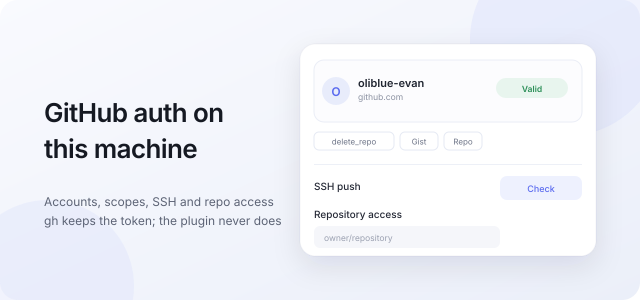

Manage GitHub CLI auth locally: sign in, switch accounts, inspect scopes, and check SSH or repository access on one page. gh keeps the credentials; the plugin never sees passwords or stores tokens.
